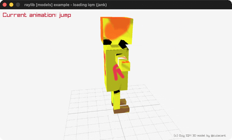

# loading-iqm

The classic IQM guy walking on loop.

Category: models. Controls: ESC.

Ported from raylib's `examples/models/models_loading_iqm.c`.



## Run it

```sh
cd loading-iqm && bb run   # from this demo (or lein run --disable-sandbox)
bb loading-iqm             # from the repo root
```

It loads files from the vendored raylib checkout (`jank-raylib-sys/raylib/examples/models/resources/`) by a path relative to this directory, so run it from here. The repo's `jank-raylib-sys/raylib` submodule has to be checked out.

## About

raylib [models] example - loading iqm, ported to jank.

The classic IQM guy walking on loop: the animated mesh and its
animation data load from two separate .iqm files, drawn lying-flat
corrected by a -90 degree X rotation. Orbital camera. ESC quits.
Based on raylib/examples/models/models_loading_iqm.c

jank-native notes:
- First IQM format (model + animations from separate files); the
  animation array binds in the outer let, with the frame threaded as
  a jank int wrapping at the keyframe count.
- The C's SetMaterialTexture(&model.materials[0], ...) is
  models.jank's set-texture!.
