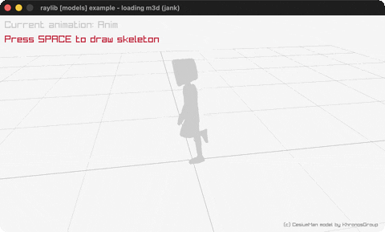

# loading-m3d

The Cesium Man in Model3D format, skeleton view on SPACE.

Category: models. Controls: LEFT/RIGHT animation, hold SPACE skeleton, ESC.

Ported from raylib's `examples/models/models_loading_m3d.c`.



## Run it

```sh
cd loading-m3d && bb run   # from this demo (or lein run --disable-sandbox)
bb loading-m3d             # from the repo root
```

It loads files from the vendored raylib checkout (`jank-raylib-sys/raylib/examples/models/resources/`) by a path relative to this directory, so run it from here. The repo's `jank-raylib-sys/raylib` submodule has to be checked out.

## About

raylib [models] example - loading m3d, ported to jank.

The Cesium Man walking in the Model3D (.m3d) format - both mesh and
animations from one file. LEFT/RIGHT switch animations, HOLD SPACE
to see the animated skeleton bones instead of the mesh. Orbital
camera. ESC quits.
Based on raylib/examples/models/models_loading_m3d.c

jank-native notes:
- First M3D format.
- The C's DrawModelSkeleton helper walks skeleton.bones[] and
  keyframePoses[frame][] with cpp/aget, taking the model and the
  animation array boxed.
