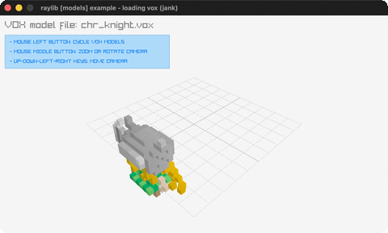

# loading-vox

Four MagicaVoxel models under a fly camera + voxel lighting.

Category: models. Controls: CLICK cycle, WASD/ARROWS move, MIDDLE-drag rotate, WHEEL zoom, ESC.

Ported from raylib's `examples/models/models_loading_vox.c`.



## Run it

```sh
cd loading-vox && bb run   # from this demo (or lein run --disable-sandbox)
bb loading-vox             # from the repo root
```

It loads files from the vendored raylib checkout (`jank-raylib-sys/raylib/examples/models/resources/`) by a path relative to this directory, so run it from here. The repo's `jank-raylib-sys/raylib` submodule has to be checked out.

## About

raylib [models] example - loading vox, ported to jank.

Four MagicaVoxel (.vox) models - knight, sword, monument, fez -
cycled with LEFT CLICK under a custom fly camera (ARROWS/WASD move,
MIDDLE-drag rotates, WHEEL zooms) and four gray point lights on the
voxel lighting shader. ESC quits.
Based on raylib/examples/models/models_loading_vox.c

jank-native notes:
- First VOX format (the last probe-first model format); the four
  Models are let-locals cycled by a per-index cond (the
  mesh-generation pattern).
- Each model is centered by a local center-xz! taking a BOXED model:
  it reads the bounding-box XZ-middle and cpp/=s a MatrixTranslate
  transform. Boxed because Model has no conversion trait.
- First UpdateCameraPro: movement/rotation Vector3s built inline
  from jank-computed key/mouse values, called on (cpp/& camera).
- Lights + uniforms ride the rlights namespace.
