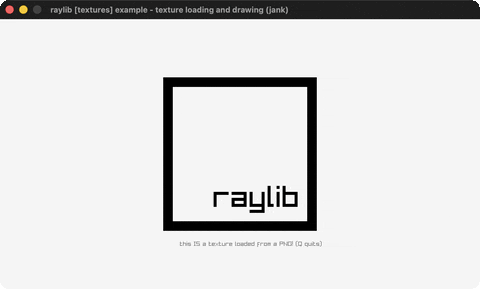

# logo-texture

The raylib logo loaded from a PNG file.

Category: textures. Controls: Q quit.

Ported from raylib's `examples/textures/textures_logo_raylib.c`.



## Run it

```sh
cd logo-texture && bb run   # from this demo (or lein run --disable-sandbox)
bb logo-texture             # from the repo root
```

It loads files from the vendored raylib checkout (`jank-raylib-sys/raylib/examples/textures/resources/`) by a path relative to this directory, so run it from here. The repo's `jank-raylib-sys/raylib` submodule has to be checked out.

## About

raylib [textures] example - texture loading and drawing, ported to
jank.

The raylib logo loaded from a PNG file and drawn centered. Q quits.
Based on raylib/examples/textures/textures_logo_raylib.c
(jank-native: FIRST file-loading example - LoadTexture reads the
PNG from the vendored raylib submodule via a path relative to the
demo's working directory, and the texture's .-width /
.-height fields center it.)
