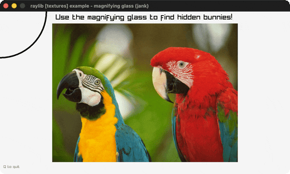

# magnifying-glass

A circular magnifier revealing hidden bunnies.

Category: textures. Controls: move mouse · Q quit.

Ported from raylib's `examples/textures/textures_magnifying_glass.c`.



## Run it

```sh
cd magnifying-glass && bb run   # from this demo (or lein run --disable-sandbox)
bb magnifying-glass             # from the repo root
```

It loads files from the vendored raylib checkout (`jank-raylib-sys/raylib/examples/textures/resources/`) by a path relative to this directory, so run it from here. The repo's `jank-raylib-sys/raylib` submodule has to be checked out.

## About

raylib [textures] example - magnifying glass, ported to jank.

A circular magnifier follows the cursor: the parrots scene is
re-rendered zoomed 2x into a 256x256 RenderTexture through a Camera2D
centred on the mouse, with hidden bunnies revealed under a MULTIPLIED
blend, then masked to a circle with a custom separate blend before
being drawn back to the screen under a ring. Q quits. Bunny & parrots
sprites by Eiden Marsal.
Based on raylib/examples/textures/textures_magnifying_glass.c

jank-native: the circular mask is generated with GenImageColor +
ImageDrawCircle through (cpp/& circle) - the pointer-taking Image API
that this arc unblocked. The Camera2D is rebuilt inline each frame with
its target set to the mouse; rlgl's rlSetBlendFactorsSeparate + the
RL_* factor constants drive the alpha-only mask blend.
