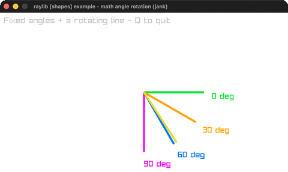

# math-angle-rotation

Fixed-angle lines + a spinning line.

Category: shapes. Controls: Q quit.

Ported from raylib's `examples/shapes/shapes_math_angle_rotation.c`.



## Run it

```sh
cd math-angle-rotation && bb run   # from this demo (or lein run --disable-sandbox)
bb math-angle-rotation             # from the repo root
```

## About

raylib [shapes] example - math angle rotation, ported to jank.

Four fixed-angle lines (0/30/60/90 degrees) plus one line that spins
through every angle, its color cycling through HSV. Q quits.
Based on raylib/examples/shapes/shapes_math_angle_rotation.c
(jank-native: C cos/sin, Vector2 built inline for DrawLineEx).
