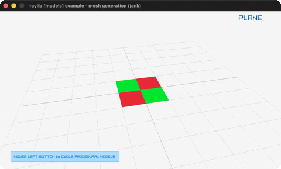

# mesh-generation

All nine procedural mesh generators, checked-textured.

Category: models. Controls: CLICK or LEFT/RIGHT cycle, ESC.

Ported from raylib's `examples/models/models_mesh_generation.c`.



## Run it

```sh
cd mesh-generation && bb run   # from this demo (or lein run --disable-sandbox)
bb mesh-generation             # from the repo root
```

## About

raylib [models] example - mesh generation, ported to jank.

All of raylib's procedural mesh generators in one gallery: plane,
cube, sphere, hemisphere, cylinder, torus, knot, polygon, plus a
hand-built one-triangle custom mesh - each checked-textured and
orbited by an auto camera. LEFT CLICK or LEFT/RIGHT cycle the
model. ESC quits.
Based on raylib/examples/models/models_mesh_generation.c

jank-native notes:
- The C's Model models[9] array cannot live in a jank vector
  (rule 2); nine outer-let locals + a per-index cond dispatching
  DrawModel (the postprocessing per-index pattern, scaled to
  models). Only the index threads through recur.
- GenMeshCustom's vertex/normal/texcoord arrays are cpp/MemAlloc
  plus cpp/unsafe-cast, filled element-wise with cpp/aget and cpp/=.
- GenImageChecked takes the two Colors inline; the atlas texture is
  assigned to all nine materials by nine explicit models.jank calls
  (a jank loop cannot carry the native models).
