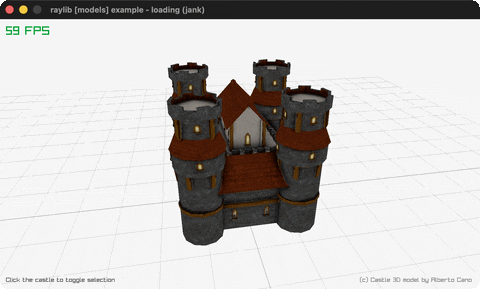

# model-loading

The castle OBJ model loaded from disk, ray-pick selection.

Category: models. Controls: LEFT CLICK select, ESC.

Ported from raylib's `examples/models/models_loading.c`.



## Run it

```sh
cd model-loading && bb run   # from this demo (or lein run --disable-sandbox)
bb model-loading             # from the repo root
```

It loads files from the vendored raylib checkout (`jank-raylib-sys/raylib/examples/models/resources/`) by a path relative to this directory, so run it from here. The repo's `jank-raylib-sys/raylib` submodule has to be checked out.

## About

raylib [models] example - loading, ported to jank.

The castle OBJ model loaded from disk with its diffuse texture,
orbited by an auto camera over a big grid. LEFT CLICK the castle to
toggle its green selection bounding box (a ray-pick against the
mesh bounds). ESC quits.
Based on raylib/examples/models/models_loading.c

jank-native notes:
- First LoadModel FROM FILE (the OBJ path): it returns a Model that
  binds as an outer-let local exactly like texture-tiling's
  LoadModelFromMesh one - zero wrapper changes.
- GetMeshBoundingBox(model.meshes[0]) is a plain struct-array read:
  (cpp/aget (.-meshes model) (cpp/int 0)). The material texture write
  goes through models.jank.
- Ray-pick selection is proven ground: (.-hit (GetRayCollisionBox
  (GetScreenToWorldRay mouse camera) bounds)) as in picking-3d.
- Simplification vs the C: the drag&drop model/texture-swap path is
  dropped (drop_files already demos dropped-file handling).
