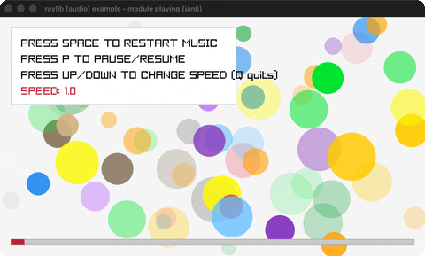

# module-playing

A chiptune XM module + pulsing circle waves.

Category: audio. Controls: SPACE restart · P pause · U/D pitch · Q quit.

Ported from raylib's `examples/audio/audio_module_playing.c`.



## Run it

```sh
cd module-playing && bb run   # from this demo (or lein run --disable-sandbox)
bb module-playing             # from the repo root
```

It loads files from the vendored raylib checkout (`jank-raylib-sys/raylib/examples/audio/resources/`) by a path relative to this directory, so run it from here. The repo's `jank-raylib-sys/raylib` submodule has to be checked out.

## About

raylib [audio] example - module playing, ported to jank.

A chiptune XM tracker module streams while 64 colored circle waves
pulse in and out. SPACE restarts, P pauses/resumes, UP/DOWN change
the pitch, Q quits.
Based on raylib/examples/audio/audio_module_playing.c
(jank-native: circles are jank maps with a palette color-id,
resolved per draw via Fade over GetColor on packed RGBA ints. The
C sets music.looping = false - a native struct-field write jank
has no surface for - so here the module simply loops.)
