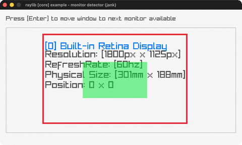

# monitor-detector

A scaled map of every attached monitor with its specs.

Category: core. Controls: ENTER next monitor · ESC.

Ported from raylib's `examples/core/core_monitor_detector.c`.



## Run it

```sh
cd monitor-detector && bb run   # from this demo (or lein run --disable-sandbox)
bb monitor-detector             # from the repo root
```

## About

raylib [core] example - monitor detector, ported to jank.

Draws a scaled map of every attached monitor with its name,
resolution, refresh rate, physical size and position; the current
monitor is outlined in red and a translucent green rectangle shows the
window's place on it. ENTER moves the window to the next monitor (when
more than one is attached). ESC quits.
Based on raylib/examples/core/core_monitor_detector.c

jank-native notes:
- GetMonitorName returns a native `const char *`; jank's `str` folds it
  straight into a jank string - `(str (cpp/GetMonitorName i))` (proven
  here, see docs/guide/jvm-surface-gaps.md).
- The C original caches monitors in a native `MonitorInfo[]` struct
  array. jank can't hold native values in a collection, so each
  monitor's Vector2 position + int fields are BOXED into a jank map the
  instant they're read (`(int (+ 0.0 (.-x pos)))`); the layout math and
  draw helper then run over plain jank data (sidesteps rule 2).
- GOTCHA that cost real debugging here: do NOT wrap an already-boxed
  jank int in `(int x)` INSIDE a `(str ...)` call. The redundant cast
  inside the string builder made jank emit C++ that member-accesses an
  `i64` and the whole file failed to compile with `member reference
  base type 'i64'`. Passing the boxed value directly - `(str ... x)`
  not `(str ... (int x))` - compiles. The plain `.-x` reads and the
  const-char* fold were both fine; the cast-inside-str was the trigger.
- `currentMonitorIndex` cycles on ENTER, so it lives in loop/recur
  state (a plain jank int).
