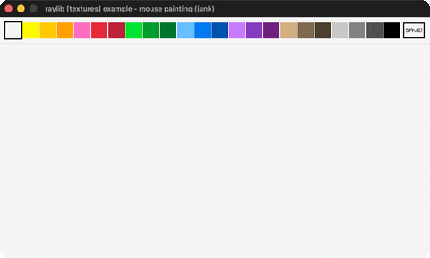

# mouse-painting

A paint program on a RenderTexture canvas.

Category: textures. Controls: LEFT paint · RIGHT erase · WHEEL brush · C clear · S save · Q.

Ported from raylib's `examples/textures/textures_mouse_painting.c`.



## Run it

```sh
cd mouse-painting && bb run   # from this demo (or lein run --disable-sandbox)
bb mouse-painting             # from the repo root
```

## About

raylib [textures] example - mouse painting, ported to jank.

A paint program on a RenderTexture canvas: LEFT paints with the
selected color, RIGHT erases (temporarily selecting the background
color), the MOUSE WHEEL sizes the brush, the top strip picks one of
23 colors, C clears, S or the SAVE button screenshots, Q quits.
Based on raylib/examples/textures/textures_mouse_painting.c
(jank-native: the palette lives as r/g/b int triples in a jank
vector, resolved per draw via GetColor on a packed RGBA int; hover
tests are plain arithmetic instead of CheckCollisionPointRec. The
C exports the canvas via LoadImageFromTexture + ImageFlipVertical,
which take an Image pointer - not reachable from jank - so saving
uses TakeScreenshot of the whole window instead.)
