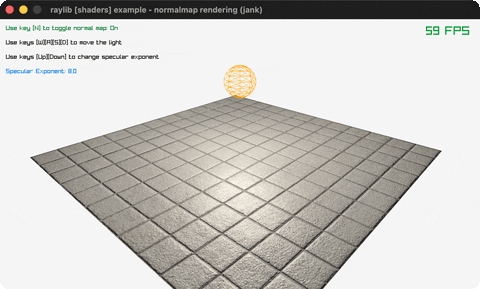

# normalmap-rendering

A spinning plane lit through a tangent-space normal map.

Category: shaders. Controls: N toggle, WASD light, UP/DOWN shininess, ESC.

Ported from raylib's `examples/shaders/shaders_normalmap_rendering.c`.



## Run it

```sh
cd normalmap-rendering && bb run   # from this demo (or lein run --disable-sandbox)
bb normalmap-rendering             # from the repo root
```

It loads files from the vendored raylib checkout (`jank-raylib-sys/raylib/examples/shaders/resources/`) by a path relative to this directory, so run it from here. The repo's `jank-raylib-sys/raylib` submodule has to be checked out.

## About

raylib [shaders] example - normalmap rendering, ported to jank.

A spinning tiled plane lit per-pixel through a tangent-space normal
map: N toggles the normal map for comparison, WASD move the point
light, UP/DOWN change the specular shininess. ESC quits.
Based on raylib/examples/shaders/shaders_normalmap_rendering.c

jank-native notes:
- First MATERIAL_MAP_NORMAL use: models.jank assigns the texture to
  the map slot, then GenTextureMipmaps and SetTextureFilter run
  against that same slot, reached with cpp/& and cpp/aget
  (GenTextureMipmaps needs the texture pointer, which only exists
  inside the material).
- plane.transform = MatrixRotateY(t) is an absolute transform SET
  (fog-rendering's spin was a multiply), spelled with cpp/=.
- Light movement is jank math: dx/dz accumulated from WASD, hand
  normalized with cpp/sqrt (no Vector3Normalize needed).
- Uniforms ride rlights' generic setters even though the
  example creates no lights - the header doubles as the shared
  uniform toolbox.
