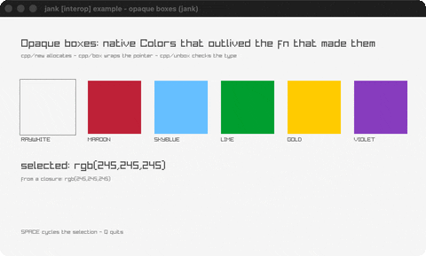

# opaque-boxes

Native Colors carried across fns in opaque boxes.

Category: interop. Controls: SPACE cycles · Q quit.

Written for this collection, not a port of a raylib example.



## Run it

```sh
cd opaque-boxes && bb run   # from this demo (or lein run --disable-sandbox)
bb opaque-boxes             # from the repo root
```

## About

jank [interop] example - opaque boxes, carrying native values across fns.

A jank fn cannot return a raylib Color directly: Color has no conversion
trait, so the compiler rejects it as 'not convertible to a jank runtime
object'. That does NOT mean the value is stuck. cpp/new allocates it,
cpp/box wraps the pointer in an ordinary jank object, and cpp/unbox takes
it back out with the type jank checks for you.

This example proves three things the boxed swatches on screen depend on:
make-color RETURNS a native Color from a fn, the boxes sit in a plain
immutable jank vector, and one is captured in a closure.

SPACE cycles the highlighted swatch, Q quits. Original example, not a
port. See docs/guide/native-value-lifetimes.md
