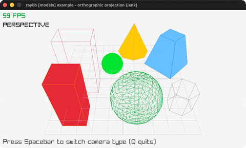

# orthographic-projection

Toggle perspective vs orthographic camera.

Category: models. Controls: SPACE toggle · Q quit.

Ported from raylib's `examples/models/models_orthographic_projection.c`.



## Run it

```sh
cd orthographic-projection && bb run   # from this demo (or lein run --disable-sandbox)
bb orthographic-projection             # from the repo root
```

## About

raylib [models] example - orthographic projection, ported to jank.

The geometric-shapes scene viewed through a camera that SPACE
toggles between perspective and orthographic projection. Q quits.
Based on raylib/examples/models/models_orthographic_projection.c
(jank-native: the C mutates camera.fovy/.projection in place; here
the Camera3D is rebuilt each frame from a jank-tracked mode int,
with the fovy boxed via an nth lookup.)
