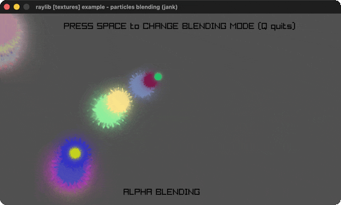

# particles-blending

Spark particles trail the mouse (alpha/additive).

Category: textures. Controls: SPACE blending · Q quit.

Ported from raylib's `examples/textures/textures_particles_blending.c`.



## Run it

```sh
cd particles-blending && bb run   # from this demo (or lein run --disable-sandbox)
bb particles-blending             # from the repo root
```

It loads files from the vendored raylib checkout (`jank-raylib-sys/raylib/examples/textures/resources/`) by a path relative to this directory, so run it from here. The repo's `jank-raylib-sys/raylib` submodule has to be checked out.

## About

raylib [textures] example - particles blending, ported to jank.

A pool of 200 spark particles trails the mouse: one activates per
frame at the cursor, falls under gravity, spins, and fades out over
~3 seconds, then is recycled. SPACE toggles ALPHA vs ADDITIVE
blending, Q quits.
Based on raylib/examples/textures/textures_particles_blending.c
(jank-native: particles are jank maps in a vector; each particle's
random color is stored as r/g/b ints and resolved per draw with
Fade over GetColor, both inline as native call arguments.)
