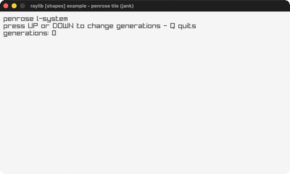

# penrose-tile

A Penrose tiling grown with an L-system.

Category: shapes. Controls: UP/DOWN generations · Q quit.

Ported from raylib's `examples/shapes/shapes_penrose_tile.c`.



## Run it

```sh
cd penrose-tile && bb run   # from this demo (or lein run --disable-sandbox)
bb penrose-tile             # from the repo root
```

## About

raylib [shapes] example - penrose tile, ported to jank.

A Penrose tiling grown with an L-system and drawn with a turtle.
UP/DOWN change the number of generations, Q quits.
Based on raylib/examples/shapes/shapes_penrose_tile.c
(jank-native: the production string is handled as a vector of one-char
string tokens - no char literals - via subs/count/reduce; the turtle
stack is a jank vector).
