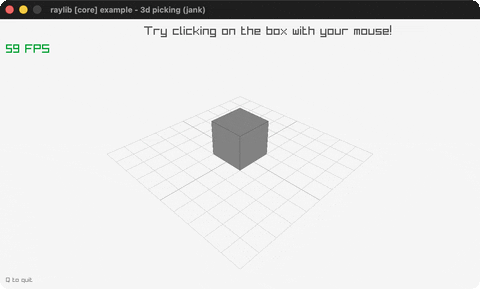

# picking-3d

Click a 3D box to pick it with a world-space ray.

Category: core. Controls: LEFT click box · Q quit.

Ported from raylib's `examples/core/core_3d_picking.c`.



## Run it

```sh
cd picking-3d && bb run   # from this demo (or lein run --disable-sandbox)
bb picking-3d             # from the repo root
```

## About

raylib [core] example - 3d picking, ported to jank.

Click the box: a ray is cast from the mouse into the 3D world with
GetScreenToWorldRay, then GetRayCollisionBox tests it against the
cube's BoundingBox. A hit turns the cube red and draws a green
selection outline; clicking again clears it. Q quits.
Based on raylib/examples/core/core_3d_picking.c

jank-native notes:
- The Camera3D is fixed (the C original's right-click first-person
  mode needs UpdateCamera(&camera, ...), which takes a pointer jank
  cannot form). The picking itself is fully faithful.
- No native value is carried in loop/recur state: the hit flag is a
  jank bool and the pick ray is rebuilt inline each frame from the
  stored screen-space click coords (the camera is static, so the
  ray is identical). The RayCollision is read for .hit inside the
  click branch and discarded.
