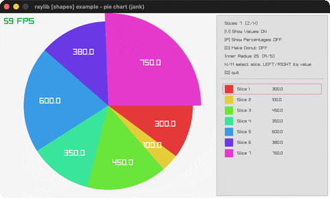

# pie-chart

An interactive pie chart with hover pop.

Category: shapes. Controls: hover · Z/X slices · N/M select · L/R value · V/P/D toggles · A/S hole · Q.

Ported from raylib's `examples/shapes/shapes_pie_chart.c`.



## Run it

```sh
cd pie-chart && bb run   # from this demo (or lein run --disable-sandbox)
bb pie-chart             # from the repo root
```

## About

raylib [shapes] example - pie chart, ported to jank.

An interactive pie chart: hovering a slice pops it out, the panel
lists every slice. Z/X change the slice count, N/M select a slice,
hold LEFT/RIGHT to change the selected slice's value, V toggles
value labels, P percentage labels, D the donut hole, A/S resize the
hole. Q quits.
Based on raylib/examples/shapes/shapes_pie_chart.c
(jank-native: the raygui spinner/checkboxes/per-slice editors become
keys with a text panel; label editing is dropped since labels never
appear on the chart itself; the donut hole draws once after the
slices instead of once per slice.)
