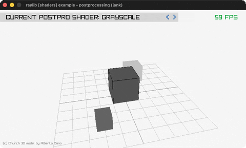

# postprocessing

Twelve full-screen post-process shaders, cycled.

Category: shaders. Controls: LEFT/RIGHT cycle effect, ESC.

Ported from raylib's `examples/shaders/shaders_postprocessing.c`.



## Run it

```sh
cd postprocessing && bb run   # from this demo (or lein run --disable-sandbox)
bb postprocessing             # from the repo root
```

It loads files from the vendored raylib checkout (`jank-raylib-sys/raylib/examples/shaders/resources/`) by a path relative to this directory, so run it from here. The repo's `jank-raylib-sys/raylib` submodule has to be checked out.

## About

raylib [shaders] example - postprocessing effects, ported to jank.

Twelve full-screen post-process shaders applied one at a time to a
render-textured 3D scene. LEFT/RIGHT cycle the effect (grayscale,
posterization, dream vision, pixelizer, cross hatching, cross
stitching, predator, scanlines, fisheye, sobel, bloom, blur); ESC
quits.
Based on raylib/examples/shaders/shaders_postprocessing.c

jank-native notes:
- The capstone of the postprocess family: the scene renders once into
  a RenderTexture, then the selected shader draws the whole texture to
  screen (y-flipped) in plain jank. Like the C, NO
  per-shader uniforms are set - each shader carries its own defaults.
- Twelve native Shader values can't live in a jank vector, so they are
  twelve outer-let locals; the active one is chosen by NESTED IFS on
  the jank-int index, then drawn once. A cond cannot do this: its
  implicit trailing nil would clash with the native Shader type.
  Only the index + effect name thread through recur - no native value
  crosses the loop.
- Intentional simplification: the C loads church.obj (the blocked
  LoadModel path); the effects only need content in the texture, so
  the scene is DrawCube primitives + a grid (the custom-uniform move).
