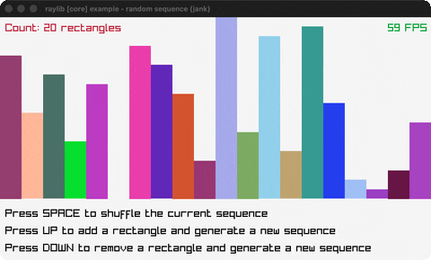

# random-sequence

Colored bars in a no-repeat LoadRandomSequence.

Category: core. Controls: SPACE shuffle, UP/DOWN count, ESC.

Ported from raylib's `examples/core/core_random_sequence.c`.



## Run it

```sh
cd random-sequence && bb run   # from this demo (or lein run --disable-sandbox)
bb random-sequence             # from the repo root
```

## About

raylib [core] example - random sequence, ported to jank.

A row of colored bars whose heights are a random *permutation* (no
repeats) produced by raylib's LoadRandomSequence. SPACE shuffles the
current bars; UP adds a bar and regenerates; DOWN removes one. ESC quits.
Based on raylib/examples/core/core_random_sequence.c

jank-native notes:
- LoadRandomSequence returns a freshly malloc'd `int *` of `count`
  shuffled values. jank indexes it directly with `cpp/aget`, which
  hands back a boxed int and needs no C.
- The C keeps a malloc'd `ColorRect[]`; jank keeps an ordinary vector
  of `{:rgba :x :y :w :h}` maps instead - no native struct array, no
  RL_CALLOC / RL_FREE. Only the LoadRandomSequence int* needs interop.
- A jank fn can't return a native Color (rule 2), so each bar stores a
  packed RGBA int and the Color is built inline at the draw call with
  `(cpp/GetColor rgba)` (the particles-blending packing trick).
