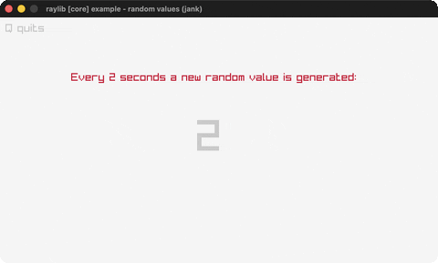

# random-values

A new random value every two seconds.

Category: core. Controls: Q quit.

Ported from raylib's `examples/core/core_random_values.c`.



## Run it

```sh
cd random-values && bb run   # from this demo (or lein run --disable-sandbox)
bb random-values             # from the repo root
```

## About

raylib [core] example - random values, ported to jank.

Every two seconds (120 frames) a new random value in [-8, 5] is shown.
Q quits. Based on raylib/examples/core/core_random_values.c
