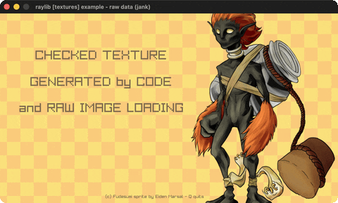

# raw-data

A .raw pixel dump + a code-generated checkerboard.

Category: textures. Controls: watch · Q quit.

Ported from raylib's `examples/textures/textures_raw_data.c`.



## Run it

```sh
cd raw-data && bb run   # from this demo (or lein run --disable-sandbox)
bb raw-data             # from the repo root
```

It loads files from the vendored raylib checkout (`jank-raylib-sys/raylib/examples/textures/resources/`) by a path relative to this directory, so run it from here. The repo's `jank-raylib-sys/raylib` submodule has to be checked out.

## About

raylib [textures] example - raw data, ported to jank.

Two textures built without a normal image file: the fudesumi sprite
loaded from a headerless 384x512 RGBA .raw pixel dump with
LoadImageRaw, and a checkerboard generated by code. Q quits. Fudesumi
sprite by Eiden Marsal.
Based on raylib/examples/textures/textures_raw_data.c

jank-native note: the C original hand-fills a MemAlloc'd `Color*`
buffer and wraps it in an Image struct literal (`.data = pixels`) for
the checkerboard. That raw-buffer path (cpp/MemAlloc + cpp/cast + aset
into a Color* + an Image struct ctor) is a deeper interop exercise not
yet proven in this repo, so the checkerboard here is produced by
GenImageChecked - visually identical (32x32 ORANGE/GOLD cells). The
LoadImageRaw half - the actual 'raw data' headline - is faithful.
