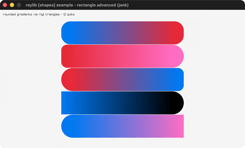

# rectangle-advanced

Rounded gradient rectangles via rlgl.

Category: shapes. Controls: Q quit.

Ported from raylib's `examples/shapes/shapes_rectangle_advanced.c`.



## Run it

```sh
cd rectangle-advanced && bb run   # from this demo (or lein run --disable-sandbox)
bb rectangle-advanced             # from the repo root
```

## About

raylib [shapes] example - rectangle advanced, ported to jank.

Five stacked rounded rectangles with horizontal gradients and
per-side roundness, built triangle by triangle in rlgl immediate
mode (the gradient falls out of OpenGL vertex-color interpolation).
Q quits.
Based on raylib/examples/shapes/shapes_rectangle_advanced.c
(jank-native: ports the RL_TRIANGLES branch of
DrawRectangleRoundedGradientH; colors pass as ids resolved to
literal rlColor4ub calls so no Color struct crosses a fn boundary;
the 12-point corner diagram becomes a destructured vector of
[x y] pairs. The both-sides-square early-out is omitted - no call
in the example reaches it.)
