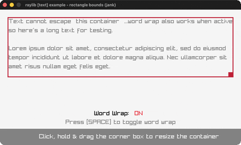

# rectangle-bounds

Word-wrapped text in a mouse-resizable container.

Category: text. Controls: drag corner to resize, SPACE toggle wrap, ESC.

Ported from raylib's `examples/text/text_rectangle_bounds.c`.



## Run it

```sh
cd rectangle-bounds && bb run   # from this demo (or lein run --disable-sandbox)
bb rectangle-bounds             # from the repo root
```

## About

raylib [text] example - rectangle bounds, ported to jank.

Text laid out inside a container rectangle you can resize by dragging the
little handle at its bottom-right corner. SPACE toggles word-wrap (on =
break between words, off = break mid-word at the edge); text that spills
past the box height is clipped. ESC quits.
Based on raylib/examples/text/text_rectangle_bounds.c

jank-native notes:
- The C's DrawTextBoxed walks codepoints and indexes font.glyphs[i] /
  font.recs[i] for per-glyph advances - native Font-array indexing, the
  same blocker class as core_random_sequence's int*. That's sidestepped
  entirely: layout measures ordinary jank substrings with MeasureTextEx
  (its Vector2 .-x re-boxed once, rule 4) and re-wraps every frame to the
  container's current inner width. Same visual result, no glyph-array
  indexing.
- Uses jank's clojure.string (str/split-lines, str/split regex) and the
  seq API (into, peek, pop) - available beside the C++ :include (see
  docs/guide/jvm-surface-gaps.md). (str/replace is NOT ported in jank
  yet - a runtime TODO - so tabs are baked into the text as spaces.)
  Word/char wrap are two small greedy passes; like the C, a word wider
  than the container falls back to a mid-word character break, so text
  never escapes the box horizontally either.
- Border/resizer Colors are chosen inline at the draw call (rule 2: a jank
  fn can't carry a native Color); the resize state is plain jank scalars
  threaded through loop/recur, no native value carried.
- The C draws a 12x12 MAROON swatch inline in the bottom caption ('drag
  the [] to resize'); the port spells it out as 'corner box' instead.
