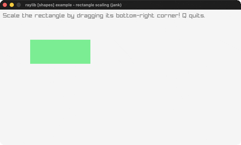

# rectangle-scaling

Resize a rectangle by its corner.

Category: shapes. Controls: drag corner · Q quit.

Ported from raylib's `examples/shapes/shapes_rectangle_scaling.c`.



## Run it

```sh
cd rectangle-scaling && bb run   # from this demo (or lein run --disable-sandbox)
bb rectangle-scaling             # from the repo root
```

## About

raylib [shapes] example - rectangle scaling, ported to jank.

Drag the bottom-right corner mark to resize the rectangle. Q quits.
Based on raylib/examples/shapes/shapes_rectangle_scaling.c
(jank-native: Rectangle + Vector2 built inline for CheckCollisionPointRec
and DrawTriangle).
