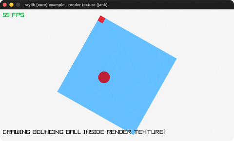

# render-texture

A ball bouncing inside a rotated off-screen render texture.

Category: core. Controls: ESC.

Ported from raylib's `examples/core/core_render_texture.c`.



## Run it

```sh
cd render-texture && bb run   # from this demo (or lein run --disable-sandbox)
bb render-texture             # from the repo root
```

## About

raylib [core] example - render texture, ported to jank.

A ball bounces inside a 300x300 off-screen RenderTexture; each frame
that texture is drawn to the main framebuffer with DrawTexturePro,
rotated about its centre. The source rectangle uses a negative height
to flip the texture vertically (render textures are y-flipped). ESC
quits.
Based on raylib/examples/core/core_render_texture.c

jank-native notes: the RenderTexture2D is a native value, so it lives
as a let-local OUTSIDE the loop (the loop closes over it) rather than
in loop/recur state (rule 2). The render-texture size is a known
constant, so its width/height are written as literals (300.0 / 150.0)
the same way magnifying_glass does - reading target.texture.width and
feeding it straight to cpp/float would be an all-native chain that
fails codegen (rule 4).
