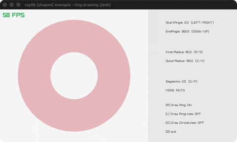

# ring-drawing

A ring/annulus with adjustable angles.

Category: shapes. Controls: L/R + U/D angles · A/S Z/X radii · O/P segments · R/L/C toggles · Q.

Ported from raylib's `examples/shapes/shapes_ring_drawing.c`.



## Run it

```sh
cd ring-drawing && bb run   # from this demo (or lein run --disable-sandbox)
bb ring-drawing             # from the repo root
```

## About

raylib [shapes] example - ring drawing, ported to jank.

A ring / annulus with adjustable angles, radii and segment count.
Hold LEFT/RIGHT for the start angle, DOWN/UP for the end angle,
A/S for the inner radius, Z/X for the outer radius, O/P for the
segment count (0 = auto). R toggles the filled ring, L the ring
outline, C the sector outline. Q quits.
Based on raylib/examples/shapes/shapes_ring_drawing.c
(jank-native: the raygui sliders/checkboxes become held-key
adjustments + toggle keys, with the control panel drawn as text.)
