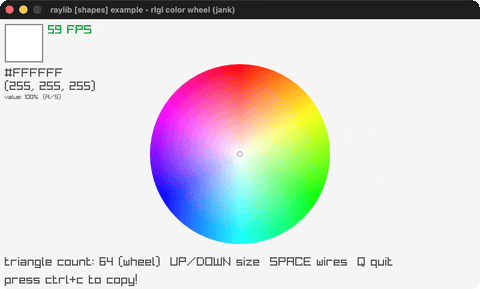

# rlgl-color-wheel

An HSV color picker wheel via rlgl.

Category: shapes. Controls: click/drag pick · WHEEL count · U/D size · A/S value · SPACE wires · CTRL+C · Q.

Ported from raylib's `examples/shapes/shapes_rlgl_color_wheel.c`.



## Run it

```sh
cd rlgl-color-wheel && bb run   # from this demo (or lein run --disable-sandbox)
bb rlgl-color-wheel             # from the repo root
```

## About

raylib [shapes] example - rlgl color wheel, ported to jank.

An HSV color wheel rendered with rlgl immediate mode. Click/drag to
pick a color (the handle clamps to the rim), mouse wheel changes the
triangle count, UP/DOWN scale the wheel, hold A/S to darken/brighten
the value, hold SPACE for wireframe, CTRL+C copies the hex code.
Q quits.
Based on raylib/examples/shapes/shapes_rlgl_color_wheel.c
(jank-native: raymath Vector2 ops are inline math; the picked Color
is read back from ColorLerp via .-r/.-g/.-b fields and stored as
jank ints; since the color is a pure function of handle position and
value it is recomputed every frame instead of only on interaction;
the raygui value slider becomes the A/S keys; %02X becomes a hex
table lookup.)
