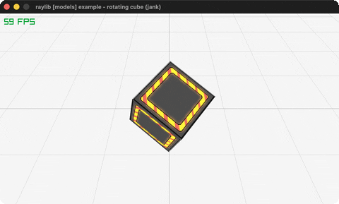

# rotating-cube

A textured cube spinning on a tilted axis (rlgl).

Category: models. Controls: ESC.

Ported from raylib's `examples/models/models_rotating_cube.c`.



## Run it

```sh
cd rotating-cube && bb run   # from this demo (or lein run --disable-sandbox)
bb rotating-cube             # from the repo root
```

It loads files from the vendored raylib checkout (`jank-raylib-sys/raylib/examples/models/resources/`) by a path relative to this directory, so run it from here. The repo's `jank-raylib-sys/raylib` submodule has to be checked out.

## About

raylib [models] example - rotating cube, ported to jank.

A single textured cube spinning about a tilted (0.5, 1, 0) axis over a
grid. ESC quits.
Based on raylib/examples/models/models_rotating_cube.c

jank-native notes:
- The C loads a Model (LoadModelFromMesh(GenMeshCube)) and spins it with
  DrawModelEx. Model/Mesh loading is jank's remaining `models` blocker,
  so the cube is drawn with rlgl immediate mode (the textured-cube
  technique) and rotated with the rlgl matrix stack: rlPushMatrix ->
  rlRotatef(angle, 0.5, 1, 0) -> emit the cube -> rlPopMatrix (the
  rlgl-solar-system technique). DrawModelEx's axis/angle map exactly onto
  rlRotatef.
- The C crops the atlas' bottom-left quarter with ImageFromImage and maps
  that whole crop over every face. That is identical to mapping the
  normalized source rect {0, 0.5, 0.5, 1.0} of the full atlas on each
  face, so we skip ImageFromImage and reuse the proven source-rect path.
- The cube-draw fn can't take the native Texture2D by value (rule 2), so
  it gets the already-read texture id + normalized source coords as jank
  data; rlSetTexture takes the boxed id fine (function coercion).
