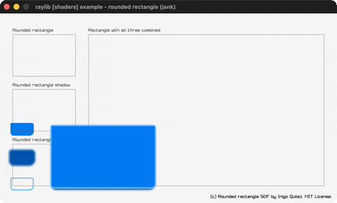

# rounded-rectangle-shader

SDF rounded rects (fill/shadow/border) in a shader.

Category: shaders. Controls: Q/ESC quit.

Ported from raylib's `examples/shaders/shaders_rounded_rectangle.c`.



## Run it

```sh
cd rounded-rectangle-shader && bb run   # from this demo (or lein run --disable-sandbox)
bb rounded-rectangle-shader             # from the repo root
```

It loads files from the vendored raylib checkout (`jank-raylib-sys/raylib/examples/shaders/resources/`) by a path relative to this directory, so run it from here. The repo's `jank-raylib-sys/raylib` submodule has to be checked out.

## About

raylib [shaders] example - rounded rectangle, ported to jank.

A signed-distance-field rounded rectangle drawn entirely in a
fragment shader (Inigo Quilez's SDF, MIT). Four panels demonstrate
the fill color, the drop shadow, the inner border, and all three
combined. This is a static scene - no controls beyond ESC/Q to quit.
Based on raylib/examples/shaders/shaders_rounded_rectangle.c

jank-native notes:
- First VEC4 uniforms: colors and the corner-radius/rectangle vectors
  all ship as 4-float SetShaderValue calls. raylib's own Vector4 and
  Vector2 ARE the contiguous float arrays SetShaderValue wants, so
  cpp/new produces the pointer directly and each uniform is one call.
- The shader samples the 'rectangle' uniform in bottom-left origin, so
  each panel's y is flipped (HEIGHT - y - h) exactly as the C does.
- Panels are plain jank data (a vector of maps); the draw loop doseqs
  over them and resolves the native Shader inline from the -main let,
  never passing it into a jank fn (which would box a native value).
