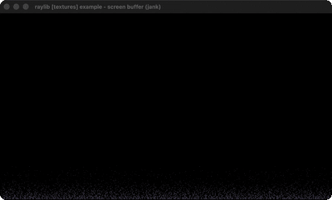

# screen-buffer

The classic DOS fire effect in a palette-indexed buffer.

Category: textures. Controls: ESC.

Ported from raylib's `examples/textures/textures_screen_buffer.c`.



## Run it

```sh
cd screen-buffer && bb run   # from this demo (or lein run --disable-sandbox)
bb screen-buffer             # from the repo root
```

## About

raylib [textures] example - screen buffer, ported to jank.

The classic DOS fire effect as a software screen buffer: a 400x225
palette-indexed byte buffer is simulated every frame (embers grow
at the bottom row, rise with random drift and decay) and blitted
through a 256-color flame palette into a texture drawn at 2x. ESC
quits.
Based on raylib/examples/textures/textures_screen_buffer.c

jank-native notes:
- The per-frame simulation touches ~90k cells twice, which is far past
  the point where ordinary jank arithmetic can keep a frame budget: a
  `loop`/`recur` iteration costs ~810 ns boxed. The hot loops here use
  `cpp/` operators on `cpp/int` values instead, which costs ~65 ns an
  iteration, and that is the whole difference between this example
  running and not.
- Measured, 400x225 = 90000 cells, ms per pass:
  C full step 0.390, jank rise 1.968, jank blit 1.880. Roughly 3.7 ms
  against a 16.7 ms budget at 60 FPS.
- The index buffer, the ember roots and the palette are plain native
  allocations reached through boxes. They are byte and Color arrays,
  not values with identity, so `cpp/MemAlloc` plus `cpp/aget` is all
  they need.
- The palette build and the two 400-wide row loops stay in ordinary
  jank: 256 and 400 iterations do not need the ceremony.
