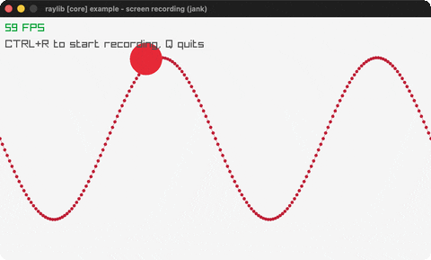

# screen-recording

Record the window to an animated GIF.

Category: core. Controls: CTRL+R start/stop, Q.

Ported from raylib's `examples/core/core_screen_recording.c`.



## Run it

```sh
cd screen-recording && bb run   # from this demo (or lein run --disable-sandbox)
bb screen-recording             # from the repo root
```

## About

raylib [core] example - screen recording, ported to jank.

A sine wave and a bouncing circle, recordable to an animated GIF.
CTRL+R starts and stops recording; the file lands next to the binary
as screenrecording.gif. Q quits.
Based on raylib/examples/core/core_screen_recording.c
(jank-native: the GIF encoder is msf_gif, a single-header library
vendored in raylib's examples. It needs MSF_GIF_IMPL defined BEFORE
the include to emit its implementation. jank's ns :include CAN express
the quoted path - a ./ prefix emits a quoted include - but it cannot
express a preprocessor define, and an ns :include is always emitted
before any top-level form. So the define stays in a cpp/raw, and the
header is then pulled in with a top-level (include ...) call, which is
the same macro the ns :include clause uses. There is no missing raylib
binding here. See docs/guide/cpp-interop-toolbox.md.

MsfGifState is a native struct that has to survive across frames.
It does not need boxing: one cpp/new before the loop gives a pointer
whose let scope covers the entire frame loop.)
