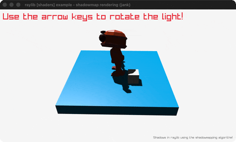

# shadowmap-rendering

Real shadows: an animated robot under a shadowmap.

Category: shaders. Controls: ARROWS light, F screenshot, ESC.

Ported from raylib's `examples/shaders/shaders_shadowmap_rendering.c`.



## Run it

```sh
cd shadowmap-rendering && bb run   # from this demo (or lein run --disable-sandbox)
bb shadowmap-rendering             # from the repo root
```

It loads files from the vendored raylib checkout (`jank-raylib-sys/raylib/examples/shaders/resources/`) by a path relative to this directory, so run it from here. The repo's `jank-raylib-sys/raylib` submodule has to be checked out.

## About

raylib [shaders] example - shadowmap rendering, ported to jank.

Real shadows via the textbook shadowmapping algorithm: pass 1
renders the scene's DEPTH from the light's orthographic camera into
a depth-only framebuffer, pass 2 renders from the player camera
with the shadow shader comparing each fragment against that depth
map. An animated robot walks among cubes; ARROW keys steer the
light, F takes a screenshot. ESC quits.
Based on raylib/examples/shaders/shaders_shadowmap_rendering.c

jank-native notes:
- FIRST MODEL ANIMATIONS: LoadModelAnimations' ModelAnimation* and
  int* out-param go through a box and (cpp/& n); jank drives
  UpdateModelAnimation by index + frame number each frame.
- The depth-ONLY framebuffer (no color attachment) is
  rendertex.jank's load-shadowmap!, the depth target minus the color
  texture.
- DrawScene draws two Models - a jank helper cannot take them bare
  (rule 2), so both arrive boxed and the same helper serves both
  passes.
- The light direction threads as three jank reals, hand-normalized;
  the light's orthographic Camera3D is rebuilt inline each frame
  from them (the per-frame-camera pattern).
- Pass-boundary matrices (rlGetMatrixModelview/Projection,
  MatrixMultiply) are frame-local native let-locals handed to
  SetShaderValueMatrix by value.
