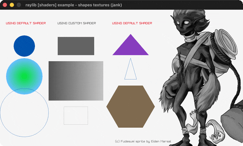

# shapes-textures-shader

A grayscale fragment shader over shapes + a sprite.

Category: shaders. Controls: ESC.

Ported from raylib's `examples/shaders/shaders_shapes_textures.c`.



## Run it

```sh
cd shapes-textures-shader && bb run   # from this demo (or lein run --disable-sandbox)
bb shapes-textures-shader             # from the repo root
```

It loads files from the vendored raylib checkout (`jank-raylib-sys/raylib/examples/shaders/resources/`) by a path relative to this directory, so run it from here. The repo's `jank-raylib-sys/raylib` submodule has to be checked out.

## About

raylib [shaders] example - shapes textures, ported to jank.

The FIRST shader example: a grayscale fragment shader toggled around
groups of shapes and a sprite with BeginShaderMode/EndShaderMode -
sections drawn with the custom shader lose their color. ESC quits.
Based on raylib/examples/shaders/shaders_shapes_textures.c

jank-native notes:
- This port unblocks the shaders category: LoadShader(0, path) works
  directly - cpp/nullptr for the default vertex shader (the
  font-loading trick), the returned Shader struct is a create-once
  outer-let local (like Font/Texture2D), and
  BeginShaderMode/EndShaderMode take it by value. No wrapper changes.
- The C's TextFormat GLSL_VERSION path becomes a plain str; desktop
  GL is GLSL 330 here.
