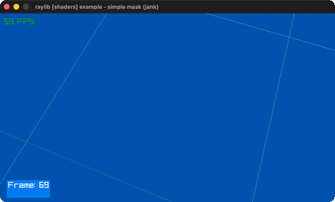

# simple-mask

An animated mask eats holes in two models' skin.

Category: shaders. Controls: WASD + mouse look, ESC.

Ported from raylib's `examples/shaders/shaders_simple_mask.c`.



## Run it

```sh
cd simple-mask && bb run   # from this demo (or lein run --disable-sandbox)
bb simple-mask             # from the repo root
```

It loads files from the vendored raylib checkout (`jank-raylib-sys/raylib/examples/shaders/resources/`) by a path relative to this directory, so run it from here. The repo's `jank-raylib-sys/raylib` submodule has to be checked out.

## About

raylib [shaders] example - simple mask, ported to jank.

A tumbling torus and a tilted cube whose plasma texture is eaten
away by an animated mask texture (holes reveal the sphere behind);
the mask rides the spare MATERIAL_MAP_EMISSION slot as a second
sampler. First-person camera (WASD + mouse). ESC quits.
Based on raylib/examples/shaders/shaders_simple_mask.c

jank-native notes:
- MATERIAL_MAP_EMISSION as a second texture slot, via models.jank's
  set-map-texture! (no mipmap setup here, unlike
  normalmap-rendering's).
- model1.transform = MatrixRotateXYZ(rotation) is an absolute cpp/=
  from three jank-threaded angles; DrawModelEx's
  axis/angle/scale args are all by-value and call directly.
- The frame counter is a jank int re-sent as an INT uniform each
  frame through the rlights setter toolbox.
