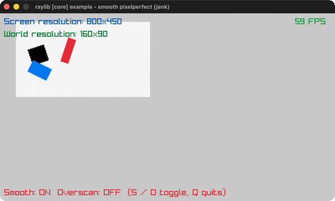

# smooth-pixelperfect

Sub-pixel smoothing of upscaled pixel art.

Category: core. Controls: S smooth · O overscan · Q quit.

Ported from raylib's `examples/core/core_smooth_pixelperfect.c`.



## Run it

```sh
cd smooth-pixelperfect && bb run   # from this demo (or lein run --disable-sandbox)
bb smooth-pixelperfect             # from the repo root
```

## About

raylib [core] example - smooth pixelperfect, ported to jank.

Three rectangles spin inside a tiny 160x90 pixel-art world rendered
to a RenderTexture and upscaled to the window. The camera sways on a
sine/cosine path; the world camera gets the integer part of its
position and the screen camera gets the sub-pixel remainder (scaled
by the 5x ratio), which smooths the upscaled motion. S toggles the
smoothing, O toggles overscan, Q quits.
Based on raylib/examples/core/core_smooth_pixelperfect.c
