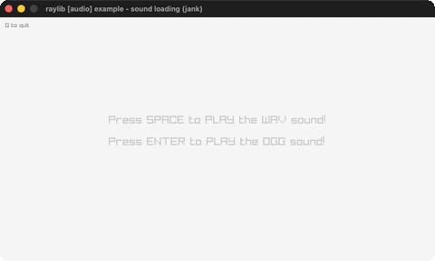

# sound-loading

Play a WAV and an OGG sound.

Category: audio. Controls: SPACE wav · ENTER ogg · Q quit.

Ported from raylib's `examples/audio/audio_sound_loading.c`.



## Run it

```sh
cd sound-loading && bb run   # from this demo (or lein run --disable-sandbox)
bb sound-loading             # from the repo root
```

It loads files from the vendored raylib checkout (`jank-raylib-sys/raylib/examples/audio/resources/`) by a path relative to this directory, so run it from here. The repo's `jank-raylib-sys/raylib` submodule has to be checked out.

## About

raylib [audio] example - sound loading, ported to jank.

The first example of the audio category: a WAV and an OGG loaded as
Sounds; SPACE plays the WAV, ENTER plays the OGG, Q quits.
Based on raylib/examples/audio/audio_sound_loading.c
(jank-native: InitAudioDevice / LoadSound / PlaySound are plain
raylib.h functions - no wrapper changes; the two Sound structs are
outer-let locals captured by the frame loop, like textures.)
