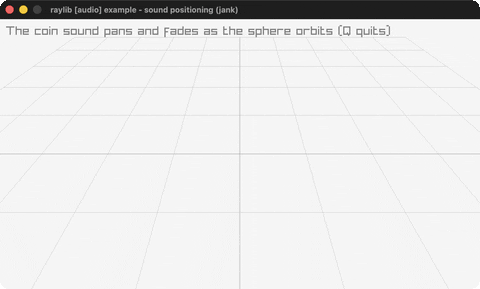

# sound-positioning

Spatial audio around an orbiting 3D sphere.

Category: audio. Controls: listen! · Q quit.

Ported from raylib's `examples/audio/audio_sound_positioning.c`.



## Run it

```sh
cd sound-positioning && bb run   # from this demo (or lein run --disable-sandbox)
bb sound-positioning             # from the repo root
```

It loads files from the vendored raylib checkout (`jank-raylib-sys/raylib/examples/audio/resources/`) by a path relative to this directory, so run it from here. The repo's `jank-raylib-sys/raylib` submodule has to be checked out.

## About

raylib [audio] example - sound positioning, ported to jank.

Spatial audio: a coin sound loops from a red sphere circling the
listener; volume attenuates with distance (and behind-the-listener
direction) while stereo pan tracks the horizontal angle. The first
3D-mode port (BeginMode3D + a Camera3D). Q quits.
Based on raylib/examples/audio/audio_sound_positioning.c
(jank-native: the camera is FIXED - the C's free-look UpdateCamera
takes a &camera pointer jank cannot form. The raymath Vector3
helpers return native structs, so the attenuation/pan math is
plain scalar jank arithmetic instead. The orbit angle threads the
loop as an accumulated frame-time sum so the chain stays boxed.)
