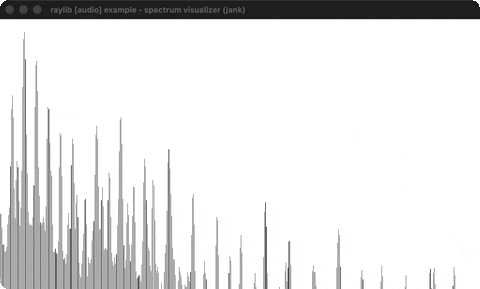

# spectrum-visualizer

A live FFT spectrum of the music through a shader.

Category: audio. Controls: ESC.

Ported from raylib's `examples/audio/audio_spectrum_visualizer.c`.



## Run it

```sh
cd spectrum-visualizer && bb run   # from this demo (or lein run --disable-sandbox)
bb spectrum-visualizer             # from the repo root
```

It loads files from the vendored raylib checkout (`jank-raylib-sys/raylib/examples/audio/resources/`) by a path relative to this directory, so run it from here. The repo's `jank-raylib-sys/raylib` submodule has to be checked out.

## About

raylib [audio] example - spectrum visualizer, ported to jank.

A decoded mp3 is pushed into a raw audio stream while each 1024-sample
window is Blackman-windowed, FFT'd, smoothed in dB and written as one
row of a rolling history. That row goes into a 512x1 texture which a
fragment shader reads to draw the spectrum.
Based on raylib/examples/audio/audio_spectrum_visualizer.c

jank-native notes:
- One 1024-point FFT per frame is far past what boxed jank arithmetic
  can afford: the same butterflies measure 72.5 ms a call written the
  ordinary way and 1.03 ms through cpp/ operators on cpp/int and
  cpp/double. The hot loops here are all native-op.
- Every buffer is a cpp/MemAlloc array behind a box, and every fn that
  touches one takes the BOX, not the pointer: a bare pointer crossing
  a fn boundary arrives as object_ref and cpp/aget has no overload for
  it. That includes closures, so the copy loops use loop/recur rather
  than dotimes or doseq.
- Verified against the C bin for bin: 506 non-zero bins agreeing to
  8.4e-05, which is float (C) against double (jank).
