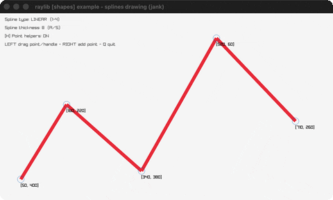

# splines-drawing

Draggable spline points, 4 spline types.

Category: shapes. Controls: 1-4 type · LEFT drag · RIGHT add · A/S thickness · H helpers · Q.

Ported from raylib's `examples/shapes/shapes_splines_drawing.c`.



## Run it

```sh
cd splines-drawing && bb run   # from this demo (or lein run --disable-sandbox)
bb splines-drawing             # from the repo root
```

## About

raylib [shapes] example - splines drawing, ported to jank.

Draggable spline points with four spline types. Keys 1-4 pick
LINEAR / BSPLINE / CATMULLROM / BEZIER, LEFT mouse drags a point (or
a gold bezier control handle), RIGHT mouse adds a point at the end,
hold A/S for thickness, H toggles the point helpers, Q quits.
Based on raylib/examples/shapes/shapes_splines_drawing.c
(jank-native: the array-taking DrawSpline* calls become per-segment
DrawSplineSegment* calls with by-value Vector2s - the same
decomposition the C shows commented out - so joints are not
thickness-compensated; the raygui dropdown/slider/checkbox become
keys; a control handle is identified as [segment-index :s|:e]
instead of a Vector2*.)
