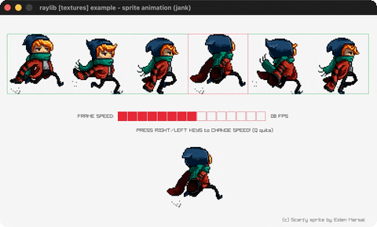

# sprite-animation

Scarfy runs: 6-frame spritesheet animation.

Category: textures. Controls: L/R animation speed · Q quit.

Ported from raylib's `examples/textures/textures_sprite_animation.c`.



## Run it

```sh
cd sprite-animation && bb run   # from this demo (or lein run --disable-sandbox)
bb sprite-animation             # from the repo root
```

It loads files from the vendored raylib checkout (`jank-raylib-sys/raylib/examples/textures/resources/`) by a path relative to this directory, so run it from here. The repo's `jank-raylib-sys/raylib` submodule has to be checked out.

## About

raylib [textures] example - sprite animation, ported to jank.

Scarfy runs: one frame of a 6-frame spritesheet is drawn at a time,
advancing on a frame counter. RIGHT/LEFT change the animation speed
(1-15 FPS), Q quits. Scarfy sprite by Eiden Marsal.
Based on raylib/examples/textures/textures_sprite_animation.c
(jank-native: the spritesheet loads from the vendored raylib
submodule relative to the demo's working dir; the frame
rectangle is rebuilt inline each draw from the current frame index
and the texture's .-width/.-height.)
