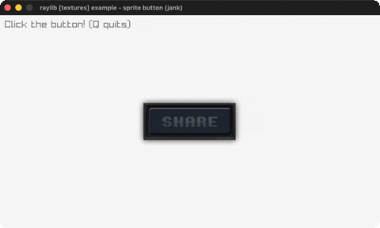

# sprite-button

A 3-state sprite button with a click sound.

Category: textures. Controls: click the button · Q quit.

Ported from raylib's `examples/textures/textures_sprite_button.c`.



## Run it

```sh
cd sprite-button && bb run   # from this demo (or lein run --disable-sandbox)
bb sprite-button             # from the repo root
```

It loads files from the vendored raylib checkout (`jank-raylib-sys/raylib/examples/textures/resources/`) by a path relative to this directory, so run it from here. The repo's `jank-raylib-sys/raylib` submodule has to be checked out.

## About

raylib [textures] example - sprite button, ported to jank.

A three-state sprite button (NORMAL / HOVER / PRESSED) drawn from a
vertically-stacked 3-frame sheet; releasing LEFT on it plays a
click sound. Q quits.
Based on raylib/examples/textures/textures_sprite_button.c
(jank-native: this is the repo's first audio use - InitAudioDevice,
LoadSound (native Sound in a let-local), PlaySound - all plain
raylib.h functions needing no wrapper changes. The hover test is
plain arithmetic on GetMouseX/GetMouseY instead of
CheckCollisionPointRec.)
