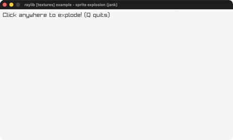

# sprite-explosion

Click to play a 5x5 explosion spritesheet + sound.

Category: textures. Controls: LEFT click · Q quit.

Ported from raylib's `examples/textures/textures_sprite_explosion.c`.



## Run it

```sh
cd sprite-explosion && bb run   # from this demo (or lein run --disable-sandbox)
bb sprite-explosion             # from the repo root
```

It loads files from the vendored raylib checkout (`jank-raylib-sys/raylib/examples/textures/resources/`) by a path relative to this directory, so run it from here. The repo's `jank-raylib-sys/raylib` submodule has to be checked out.

## About

raylib [textures] example - sprite explosion, ported to jank.

Click anywhere to spawn an explosion: a 5x5 spritesheet plays one
frame at a time (every 3 game frames) at the click point while a
boom sound plays. Only one explosion runs at a time. Q quits.
Based on raylib/examples/textures/textures_sprite_explosion.c
(jank-native: no native Vector2/Rectangle is carried in loop state -
the click position is kept as jank ints and the frame rectangle is
rebuilt inline from the current frame/line and the texture's frame
size.)
