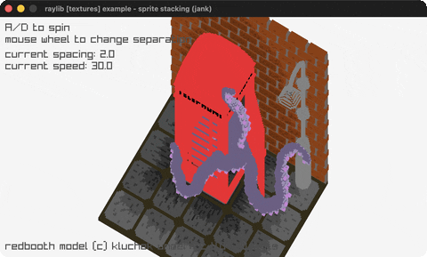

# sprite-stacking

A voxel booth from 122 stacked rotated slices.

Category: textures. Controls: A/D spin · WHEEL separation · Q quit.

Ported from raylib's `examples/textures/textures_sprite_stacking.c`.



## Run it

```sh
cd sprite-stacking && bb run   # from this demo (or lein run --disable-sandbox)
bb sprite-stacking             # from the repo root
```

It loads files from the vendored raylib checkout (`jank-raylib-sys/raylib/examples/textures/resources/`) by a path relative to this directory, so run it from here. The repo's `jank-raylib-sys/raylib` submodule has to be checked out.

## About

raylib [textures] example - sprite stacking, ported to jank.

A voxel-style booth built by stacking 122 horizontal slices of one
spritesheet with DrawTexturePro, each rotated to the same angle and
offset vertically to fake height. A/D (or LEFT/RIGHT) spin it, the
mouse wheel changes the slice separation. Q quits. Redbooth model
(c) kluchek under CC 4.0.
Based on raylib/examples/textures/textures_sprite_stacking.c
(jank-native: rotation/spacing/speed are plain jank reals in loop
state; every slice's source/dest Rectangle and origin Vector2 is
constructed inline as a DrawTexturePro argument, never carried.)
