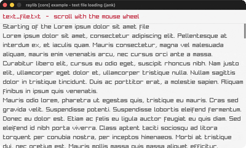

# text-file-loading

Load + word-wrap a text file, scroll it.

Category: core. Controls: mouse wheel scroll, ESC.

Ported from raylib's `examples/core/core_text_file_loading.c`.



## Run it

```sh
cd text-file-loading && bb run   # from this demo (or lein run --disable-sandbox)
bb text-file-loading             # from the repo root
```

It loads files from the vendored raylib checkout (`jank-raylib-sys/raylib/examples/core/resources/`) by a path relative to this directory, so run it from here. The repo's `jank-raylib-sys/raylib` submodule has to be checked out.

## About

raylib [core] example - text file loading, ported to jank.

Loads a text file, word-wraps every line to the window width and lets you
scroll through it with the mouse wheel; a little scrollbar on the right
shows how far you've read. ESC quits.
Based on raylib/examples/core/core_text_file_loading.c

jank-native notes:
- LoadFileText returns an owned `char *` that jank's `str` copies into a
  jank string (then UnloadFileText frees it). The C word-wraps by mutating
  that char buffer in place (writing '\n', temporarily null-terminating to
  call MeasureText); jank strings are immutable, so the wrap is
  reimplemented cleanly: `clojure.string/split-lines` splits into lines and
  each line is greedily packed onto sub-lines using MeasureText on ordinary
  substrings. Same visual result, no in-place mutation.
- jank ships the full clojure.core seq API and clojure.string; `:require`
  coexists with a C++ `:include` in one ns form (jank's own shell.jank does
  this). So this uses str/split-lines, str/split (regex) and filterv rather
  than hand-rolled scanners. `into` flattens the per-line wraps.
- The C scrolls a Camera2D; a plain y-offset subtracted from each line's
  position is identical here and avoids BeginMode2D.
