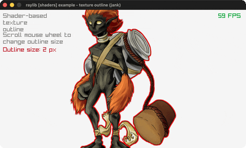

# texture-outline

A shader-drawn outline around a sprite.

Category: shaders. Controls: mouse wheel outline size, ESC.

Ported from raylib's `examples/shaders/shaders_texture_outline.c`.



## Run it

```sh
cd texture-outline && bb run   # from this demo (or lein run --disable-sandbox)
bb texture-outline             # from the repo root
```

It loads files from the vendored raylib checkout (`jank-raylib-sys/raylib/examples/shaders/resources/`) by a path relative to this directory, so run it from here. The repo's `jank-raylib-sys/raylib` submodule has to be checked out.

## About

raylib [shaders] example - texture outline, ported to jank.

A fragment shader draws a red outline around the fudesumi sprite's
alpha edge; the mouse wheel grows/shrinks the outline thickness (a
float uniform updated every frame). ESC quits.
Based on raylib/examples/shaders/shaders_texture_outline.c

jank-native notes:
- FIRST shader-uniform proof: SetShaderValue takes a const void*
  pointing at the value. cpp/new produces exactly that, and raylib's
  Vector4/Vector2 are already contiguous floats, so no C and no
  shared buffer is involved.
- GetShaderLocation returns an int (boxed with int); the
  SHADER_UNIFORM_* enum constants pass straight through.
