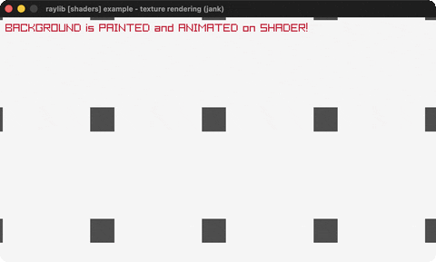

# texture-rendering

A blank texture painted entirely by a fragment shader.

Category: shaders. Controls: ESC.

Ported from raylib's `examples/shaders/shaders_texture_rendering.c`.



## Run it

```sh
cd texture-rendering && bb run   # from this demo (or lein run --disable-sandbox)
bb texture-rendering             # from the repo root
```

It loads files from the vendored raylib checkout (`jank-raylib-sys/raylib/examples/shaders/resources/`) by a path relative to this directory, so run it from here. The repo's `jank-raylib-sys/raylib` submodule has to be checked out.

## About

raylib [shaders] example - texture rendering, ported to jank.

A 1024x1024 BLANK texture drawn through the cubes_panning fragment
shader: every visible pixel is painted and animated by the shader
(two layers of panning cube grids), the texture itself is empty.
ESC quits.
Based on raylib/examples/shaders/shaders_texture_rendering.c

jank-native notes:
- The simplest animated-uniform shader port: one FLOAT uniform
  (uTime) re-sent every frame as a plain SetShaderValue over a
  cpp/new float, fed from GetTime rather than an accumulated frame delta.
