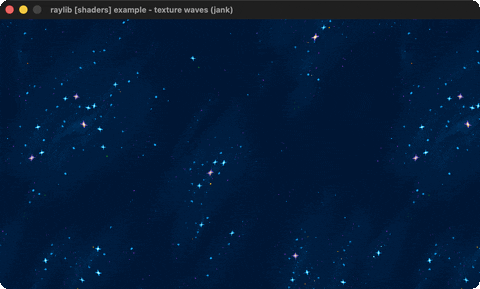

# texture-waves

A space texture rippled by an animated wave shader.

Category: shaders. Controls: ESC.

Ported from raylib's `examples/shaders/shaders_texture_waves.c`.



## Run it

```sh
cd texture-waves && bb run   # from this demo (or lein run --disable-sandbox)
bb texture-waves             # from the repo root
```

It loads files from the vendored raylib checkout (`jank-raylib-sys/raylib/examples/shaders/resources/`) by a path relative to this directory, so run it from here. The repo's `jank-raylib-sys/raylib` submodule has to be checked out.

## About

raylib [shaders] example - texture waves, ported to jank.

A space texture rippled by a sine-wave fragment shader driven by a
'seconds' uniform that advances with frame time - the waves animate
continuously. ESC quits.
Based on raylib/examples/shaders/shaders_texture_waves.c

jank-native notes:
- Third shader port: seven float uniforms plus a vec2, each a plain
  SetShaderValue over cpp/new. Nothing is shared between calls, so
  they are free to live anywhere rather than being confined to -main. The 'seconds' uniform updates every frame from
  a jank real accumulated with GetFrameTime.
