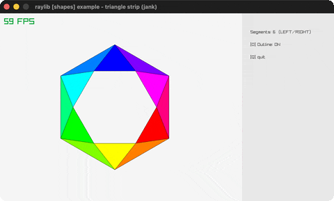

# triangle-strip

A rainbow triangle-strip fan.

Category: shapes. Controls: L/R segments · O outline · Q quit.

Ported from raylib's `examples/shapes/shapes_triangle_strip.c`.



## Run it

```sh
cd triangle-strip && bb run   # from this demo (or lein run --disable-sandbox)
bb triangle-strip             # from the repo root
```

## About

raylib [shapes] example - triangle strip, ported to jank.

A rainbow fan of triangles between an inner and an outer radius.
Hold LEFT/RIGHT to change the segment count, O toggles the black
outline, Q quits.
Based on raylib/examples/shapes/shapes_triangle_strip.c
(jank-native: the C fills a Vector2 points[122] array then indexes
it; here each triangle's four corners are recomputed inline from the
same angle formulas - the i+1 wrap falls out of cos/sin periodicity.)
