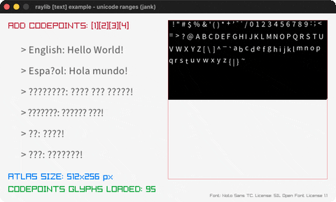

# unicode-ranges

Grow a multilingual font atlas by unicode range.

Category: text. Controls: 0-4 select range set, ESC.

Ported from raylib's `examples/text/text_unicode_ranges.c`.



## Run it

```sh
cd unicode-ranges && bb run   # from this demo (or lein run --disable-sandbox)
bb unicode-ranges             # from the repo root
```

It loads files from the vendored raylib checkout (`jank-raylib-sys/raylib/examples/text/resources/`) by a path relative to this directory, so run it from here. The repo's `jank-raylib-sys/raylib` submodule has to be checked out.

## About

raylib [text] example - unicode ranges, ported to jank.

Multilingual test strings (English/Spanish/Greek/Russian/Chinese/
Japanese) drawn with NotoSansTC. The font starts with the basic ASCII
range; keys 1-4 rebuild it with progressively larger unicode ranges
(European -> +Greek -> +Cyrillic -> +CJK), 0 resets to ASCII. The
growing atlas is shown scaled on the right. Range 4 requests ~40k CJK
codepoints and takes a while (the C warns the same). ESC quits.
Based on raylib/examples/text/text_unicode_ranges.c

jank-native notes:
- The Font is unloaded + reloaded at runtime, so it lives as an opaque
  box in a jank atom (the viewport-scaling frame-crossing pattern),
  which lets the box be swapped when the font is rebuilt.
- The rebuild copies the font's current glyph values via the
  struct-array subscript (cpp/aget (.-glyphs font) (cpp/int i)) +
  .-value reads - the first committed load-bearing GlyphInfo aget -
  then appends the new range into a cpp/MemAlloc int array (the
  codepoints-loading technique) and reloads with LoadFontEx.
- raylib keeps only codepoints actually present in the font
  (WARNING: 'Requested codepoints glyphs found: [x/y]'), so glyph
  counts reflect NotoSansTC's real coverage, exactly like the C.
- The C's switch falls through case 4 -> 3 -> 2 -> 1 (each range mode
  includes the ones below); the port makes that explicit with
  cumulative vectors of [start stop] pairs.
- The multilingual literals are UTF-8 in-source (proven in
  codepoints-loading); comments stay ASCII.
